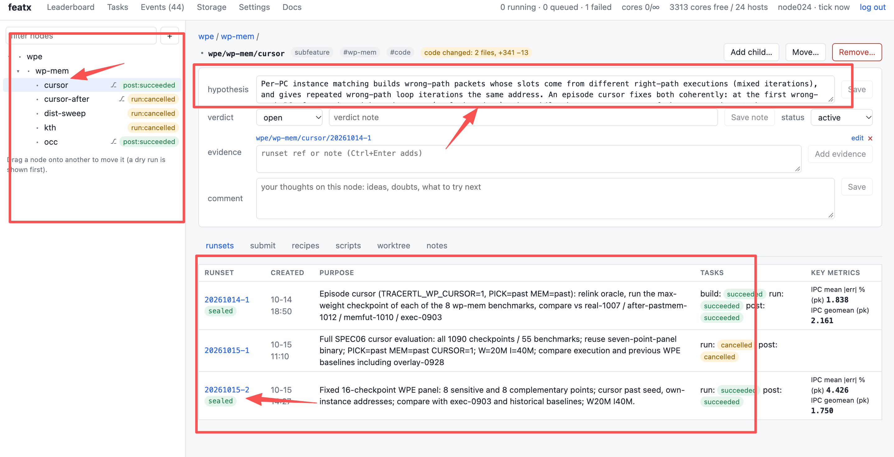
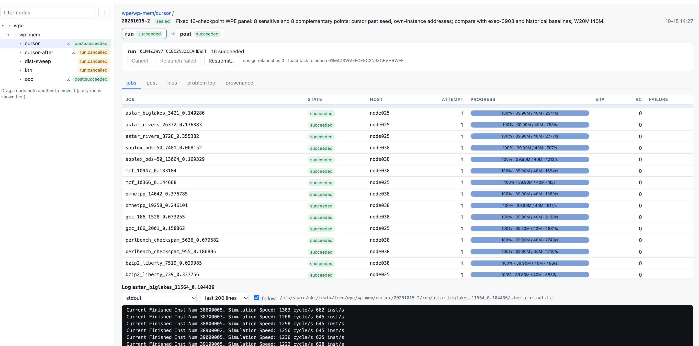

# featx

## 简介

featx 是一个面向香山的功能探索和实验任务调度的系统：它用树形结构管理 feature、代码上下文、构建、运行、日志和后处理，并通过 CLI、MCP 和 Web UI 与人和 AI 协作。

> 如果针对其他项目开发，也可参考 intent.md 进行重写。

- 主界面



- 任务界面




### 动机

- 功能探索会产生大量 worktree ，需要记忆每个分支的用途，命名也是件难事。
- 构建和运行日志分散在不同目录，难以回溯和比较。
- 多个测试任务需要同时运行时，手动脚本需要打开多个终端。
    - Agent 自己轮询 build 和运行状态会消耗 token，也会拖慢开发过程。
    - CI 并不总是方便使用，本地任务仍然需要统一调度。
- 切换 session 或模型提供商时，需要反复向 Agent 注入之前的上下文。

### 实现策略

- 使用树形结构管理开发上下文，每个 feature 或 subfeature 都是树上的一个节点。
    - 节点关联对应的 worktree、branch、构建产物、运行日志、实验动机，实验数据和结论。
    - 每个 feature 可以定义 build、run、post recipe，并创建多个 runset。
        * build: 构建参数
        * run: 运行参数
        * post: 后处理方式
    - 之后可以通过诸如 <feature, subfeature, .., runset> 的标签来引用之前的任意实验。
- featx 负责构建、运行、后处理、任务调度、状态监控和上下文记录。
    - 提供 CLI、MCP 和 Web UI；人和 Agent 使用同一套任务状态和日志。
    - 运行进度、资源占用、失败原因和后处理结果集中展示。


## 安装方式

### Agent

可以直接告诉 Agent：

```text
帮我配置这个项目 (https://github.com/trace1729/featx.git) 请检查当前服务器上的仓库、工具链和共享数据路径，生成 featx 配置，运行 featx doctor，并启动 featxd, 如果缺少什么必要的输入提示我。
```

Agent 通常会完成以下步骤：

```bash
git clone <featx-repo> featx
cd featx
uv venv .venv
uv pip install --python .venv/bin/python -e .
export PATH=$PWD/.venv/bin:$PATH
featx init --site <site-profile> --repo <code-repository> --daemon-host <host>
featx doctor
featx daemon start
```

如果使用已有的 featx 数据根目录，可以使用 `featx init --adopt --root <root>`。站点配置应描述共享的 checkpoint、trace、工具和可调度主机；个人配置描述代码仓库、worktree 根目录和本地工具路径。详细配置以 `featx config show effective` 为准。

### Manual

要求：Python 环境、可用的 `uv`、Git，以及任务主机之间的免密 SSH。featx checkout、数据根目录和 worktree 根目录应位于所有任务主机都能访问的位置。

```bash
git clone <featx-repo> featx
cd featx
uv venv .venv
uv pip install --python .venv/bin/python -e .
export PATH=$PWD/.venv/bin:$PATH

featx init --site <site-profile> --repo <code-repository> --daemon-host <host>
featx doctor
featx daemon start
```

安装完成后，可以用 `featx config show effective` 查看最终配置，用 `featx daemon status` 查看调度器状态。


## 使用方式

### Agent

可以用自然语言描述目标，例如：

```text
我要在香山上运行 SPEC06。请创建一个 feature 节点(test-spec26), 执行模式构建，运行指定的 checkpoint，完成后执行后处理并汇总结果，如果缺少什么必要的输入提示我。
```

或者：

```text
我要查看前端控制台。请启动或检查 featxd，告诉我 Web UI 地址和访问 token 的位置。
```

Agent 可以通过 CLI/ MCP 获取 feature 上下文、提交任务、查看进度、读取日志、处理失败事件和记录实验结论。
提交任务后，Agent 可使用 CLI 的 featx wait 或者 MCP 的`task_wait` 等待任务完成，避免反复轮询任务状态。
也可以使用`featx wait TASK1 TASK2 --timeout 3600` 等待多个任务。

### Manual

创建 feature 节点并提交一次完整任务：

```bash
featx node add backend/rob/feature1 -p \
  -H "探索 ROB 的新策略" --worktree

featx recipe set backend/rob/feature1 run \
  workload=spec06 mode=exec
featx submit backend/rob/feature1
featx wait <task-id>                 # 事件驱动等待任务完成，不需要轮询
```

查看任务和日志：

```bash
featx tree
featx ps
featx eta
featx logs <task-id> -j <point> -f
featx events --wait 600
```

提交已有二进制、选择 checkpoint 或覆盖单次参数：

```bash
featx submit backend/rob/feature1 run --bin <emu> \
  --point <benchmark_point> --set run.I=200000 --set run.W=200000
```

查看 Web UI：

```bash
featx ui
```

按照输出建立 SSH tunnel，然后在浏览器打开 `/ui/`。Web UI 可以查看树、任务、runset、实时日志、后处理报告和容量配置。


## 附录

### 目录组织形式

```text
$FEATX_ROOT/
  featx.yaml                 # 个人配置层
  daemon.json                # daemon 状态和连接信息
  bincache/<key>/emu         # 构建缓存和产物
  events/                    # 失败、重试和完成事件
  tasks/                     # 调度任务状态
  tree/<category>/<feature>/
    node.yaml                # hypothesis、verdict、evidence 等
    recipes/                 # build、run、post 配置
    scripts/                 # 节点脚本
    <runset>/                 # experiment、build、run、post 和日志
```

### 常用命令

```bash
featx doctor                         # 检查路径、工具和主机
featx config show effective          # 查看生效配置
featx tree                           # 查看 feature 树和状态
featx node add <path> --worktree     # 创建 feature 节点
featx recipe set <path> run ...      # 设置运行 recipe
featx submit <path>                  # 提交 build -> run -> post
featx wait <task-id>                 # 等待任务完成，不轮询
featx ps                             # 查看任务
featx eta                            # 查看预计完成时间
featx logs <task> -j <point> -f      # 跟踪任务日志
featx result <runset>                # 查看结果
featx task relaunch <task>           # 重新发起失败任务
featx log append <runset> ...        # 记录问题和修复
featx node set <path> --verdict ...  # 记录实验结论
featx daemon status                  # 查看 daemon 状态
featx daemon stop                    # 停止 daemon
```

### 工作流

```
通用工作流
1. 人/Agent 明确实验目的、约束和预期结果。
2. 创建 feature 节点，填写 hypothesis、recipe 和必要的上下文。
3. Agent 根据约束在该节点的 worktree 中实现代码。
4. 人/Agent 审查代码和输入，确认实验内容。
5. Agent 向 featx 提交 build、run、post 任务。
6. featxd 在可用主机上调度任务，保存日志和产物。
7. 人/Agent 查看结果，判断是否支持假设，并把结论记录在节点或 runset 中。

代码、脚本或参数发生变化时，应创建新的 derived runset；只进行基础设施重试时，可以保留在同一个 runset 中。
```

```bash
具体例子
# 1. 创建探索节点
featx node add frontend/bpu/cursor -p \
  -H "评估 anchor 之后的连续指令选择" --worktree

# 2. 配置运行参数和后处理
featx recipe set frontend/bpu/cursor run \
  workload=spec06 mode=exec
featx recipe set frontend/bpu/cursor post -f post.yaml

# 3. 提交任务并观察进度
featx submit frontend/bpu/cursor
featx tree
featx logs <task-id> -j <point> -f

# 4. 记录结果和结论
featx log append frontend/bpu/cursor/<runset> \
  -p "问题描述" -s "采用的修复或实验策略" -c "代码和配置说明"
featx node set frontend/bpu/cursor \
  --verdict supported --evidence <runset>
```

### 默认配置

- 默认关闭 trace
    - 不管理 TraceRTL
    - `doctor` 跳过 trace manifest 和 trace 目录检查。
- 用户数据目录使用 `${share}/${USER}/...`，`${USER}` 取运行 featx 的用户名；任务主机默认 `localhost`，实验基线需自行注册。
    - 个人部署信息建议保存在仓库外的 site YAML，通过 `site: /path/to/private-site.yaml` 引用。`problem-analysis.log` 是本地记录，不纳入版本控制。
- `nfs-share` 站点默认使用 `${share}/ci-workloads/DRAMsim3`（需要已有 `build/`）
- `nfs-share` 站点的 `${share}/...` 路径优先使用 `/nfs/share`，路径不存在时回退到 `/nfs/home/share`；
- `featx init` 未指定 `--site` 时自动检测站点；`--site none` 禁用检测。
- 未配置 `paths.nemu_diff` 时使用代码仓库 `ready-to-run/` 下可用的 NEMU 参考库，设为空字符串可禁用 diff。常用分析脚本随包提供，`analysis_dir` 仅用于覆盖位置。


更多 recipe、checkpoint、point selection、后处理插件和 MCP 接口说明，参见 [`featx/docs/reference.md`](featx/docs/reference.md)。
